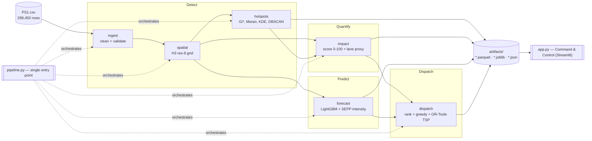

<div align="center">

# ParkSight

### Pre-Emptive Enforcement Dispatcher for Parking-Induced Congestion

**Flipkart Gridlock 2.0 Hackathon -> Round 2**
**Problem Statement 1 - Poor Visibility on Parking-Induced Congestion**

**Pipeline -> Detect → Quantify → Predict → Dispatch → Prove.**

</div>

---

## Table of contents

1. [Overview](#1-overview)
2. [Headline results](#2-headline-results)
3. [Why ParkSight is defensible](#3-why-parksight-is-defensible)
4. [System architecture](#4-system-architecture)
5. [Methodology — the five stages](#5-methodology--the-five-stages)
6. [The Command & Control dashboard](#6-the-command--control-dashboard)
7. [Evaluation (model vs baseline)](#7-evaluation-model-vs-baseline)
8. [Reading the dashboard numbers](#8-reading-the-dashboard-numbers)
9. [Project layout](#9-project-layout)
10. [Quickstart (local)](#10-quickstart-local)
11. [Run with Docker (one-click)](#11-run-with-docker-one-click)
12. [Deploy to a Hostinger KVM VPS](#12-deploy-to-a-hostinger-kvm-vps)
13. [Testing](#13-testing)
14. [Dataset & compliance](#14-dataset--compliance)
15. [Configuration](#15-configuration)
16. [Tech stack](#16-tech-stack)
17. [License](#17-license)

---

## 1. Overview

Today, parking enforcement is **reactive** - officers patrol blindly and ticket a vehicle
after it has already blocked a lane for an hour. There is no live heatmap of where illegal
parking is choking traffic, and no way to prioritise which zones to police first.

ParkSight makes enforcement **pre-emptive**. Illegal parking is a behavioural pattern - the
same places, the same hours, every week - which makes it **predictable**. ParkSight learns
that pattern from **298,450** real violation records, proves the hotspots are statistically
significant, forecasts the next hour's risk, and tells the control room exactly **which units
to send where** - with the recovered road capacity attached to every order.

It is a lightweight, **CPU-only, fully reproducible** Python pipeline that ends in a Streamlit
**Command & Control dashboard**, and ships as a **one-click Docker deployment**.

---

## 2. Headline results


| Metric | Value |
|---|---|
| Records processed | **298,450** (298,448 valid for spatial analysis) |
| H3 hexagons populated | **2,532** (1,698 active full-period · 1,519 training-period) |
| Significant hotspots | **112** Getis-Ord Gi\* (p < 0.05) + **70** High-High clusters |
| Spatio-temporal panel | **5,504,856** rows (active hex × hourly window) |
| Forecasting performance | **Outperformed persistence baseline across all evaluated metrics** |
| &nbsp;&nbsp;• MAE / RMSE | **0.053 / 0.675** vs 0.083 / 0.935 |
| &nbsp;&nbsp;• Precision@5 / @10 / @20 | **0.380 / 0.441 / 0.510** vs 0.353 / 0.415 / 0.476 |
| Dispatch | **10** plain-English orders for 10 units, OR-Tools routed |
| Pipeline runtime (CPU only) | **~5 min** end-to-end on CPU hardware |
| Automated tests | **172 passing** (unit + Hypothesis property tests + integration) |

---

## 3. Why ParkSight is defensible

1. **Built on the complete dataset.** Analysis is performed directly on **Uber H3 hexagons** (resolution 9, ~0.105 km²) generated from latitude and longitude coordinates. This avoids dependence on `junction_name`, which is unavailable ("No Junction") for nearly half of the records. Human-readable location labels are attached only during the final reporting stage.
2. **Statistically validated hotspot detection.** Hotspots are identified using **Getis-Ord Gi\*** and **Local Moran's I** statistics. Areas are classified based on statistical significance at the 95% confidence level rather than raw violation counts alone.
3. **Dataset-driven analysis.** All analytical outputs are derived exclusively from the provided `dataset`. External sources are not used for modeling or decision-making. Map tiles are included only for visualization purposes.
4. **Transparent forecasting methodology.** The forecasting model (LightGBM with Tweedie objective) is trained and evaluated using a chronological split to reflect real-world deployment conditions. Results are reported alongside a persistence baseline for comparison.
5. **Reproducible pipeline.** The project follows a deterministic workflow with fixed random seeds, a single execution pipeline, and reproducible outputs across repeated runs.

---

## 4. System architecture

Each stage consumes a well-defined DataFrame contract and writes cached artifacts; the
dashboard loads those artifacts and **never recomputes**.



---

## 5. Methodology :- the five stages

### 1 · Detect
The **Data_Ingestor** loads, parses, validates and deduplicates `PS1.csv`: of 298,450 records,
298,448 are valid for spatial analysis (2 excluded by the inclusive Bengaluru bounding box).
The **Spatial_Aggregator** bins every validated violation onto exactly one H3 hexagon
(resolution 9) - 2,532 populated cells. The **Hotspot_Detector** then *proves* significance:
a **Getis-Ord Gi\*** statistic (seed-fixed permutation p-values) flags **112** statistically
significant high-density hotspots at 95% confidence, and **Local Moran's I** flags **70**
High-High spatial clusters. A KDE surface and DBSCAN cluster boundaries support visualization.

### 2 · Quantify
The **Impact_Quantifier** computes a deterministic, dataset-derived **Congestion Impact Score
(0–100)** per active hexagon as a transparent weighted composite: violation **severity** (0.30),
**density** per unit area (0.30), **persistence** across distinct days (0.20), and a **vehicle
factor** weighting larger vehicles higher (0.20). A transparent **Lane Capacity Proxy** then
translates the score into carriageway metres blocked/recovered and % road capacity recovered.
Every coefficient is surfaced in the dashboard for audit; identical inputs always yield
identical scores.

### 3 · Predict
ParkSight uses a single **LightGBM (Tweedie loss)** model trained on a leakage-safe spatio-temporal dataset with 22 features capturing temporal patterns, spatial relationships, climatology, and self-excitation effects. Inspired by the SEPP/Hawkes framework of George Mohler, the final risk forecast combines seasonal background risk with temporal and spatial near-repeat behavior, with weights selected using validation Precision@10. A bounded background component ensures meaningful risk rankings across nearly all hexagons during low-activity periods without changing the order of genuinely active hotspots.

> **Quiet-hour risk surface (no dead map).** At quiet hours almost every cell has zero recent
> activity, so a pure near-repeat forecast would collapse to a single non-zero zone. The live
> surface layers a **bounded background tie-break** (hour-of-week climatology + spatial
> near-repeat + base rate), capped strictly below the smallest positive near-repeat risk, so it
> never reorders a genuinely active zone — it only differentiates the otherwise-tied quiet tail.
> The latest window goes from one ranked zone to **1,515 of 1,519** differentiated hexagons.

### 4 · Dispatch
The **Dispatch_Planner** ranks targets by **Congestion Impact Score × predicted risk** for the
next 60-minute window (not raw forecast rank), selects zones with a greedy maximum-coverage
strategy for a limited number of units, and sequences each route with **OR-Tools** TSP over
haversine distances. Each target hexagon is snapped to its nearest non-blank junction/police
label, falling back to the H3 id. Output is a plain-English order, e.g.
"Dispatch UNIT-1 to KR Market Junction: predicted risk of 0.62 violations in the next 60 minutes."

### 5 · Prove
The **Command & Control dashboard** (`app.py`) closes the loop — see below. It loads cached
artifacts only and degrades to clear empty/error states rather than fabricating content.

---

## 6. The Command & Control dashboard

An enterprise dark-slate ops console that loads **only** the cached artifacts - it never needs
the raw `PS1.csv` at runtime, so it deploys as a live link. Four views:

| Tab | What it shows | Real-time? |
|---|---|---|
| **Operations** | Next-60-min predicted-risk map (toggle to congestion-impact or significant-hotspot layers) + Smart Dispatch Panel + Impact Counters | Forecast for the hour after the dataset ends |
| **Live Now** | Current wall-clock time mapped to the matching historical day-of-week × hour, with the forecaster's risk for "right now" | Demonstration on historical data (clearly labelled) |
| **Live Feed** | The forecaster streamed hour-by-hour over the most recent week - shows the forecast surface, then **reveals the actual** violations, with a live Precision@10 hit-rate | Simulated live feed on historical data (clearly labelled) |
| **Historical Replay** | Scrub observed violations across the whole dataset period with date/hour sliders | Observed history |
| **Run on your CSV** | Upload a same-schema CSV and run the **full pipeline live** (with a per-stage progress bar) on *your* data, then view its Operations map, dispatch panel and impact counters | Live pipeline run on uploaded data - isolated per run; the demo is never touched |

All "live" views are powered by a single precomputed artifact, `forecast_replay.parquet`
(one trailing week × active hexagons of forecast-vs-actual), so the console stays pure-artifact
while honestly demonstrating the operational forecaster on real outcomes.

> **The "Run on your CSV"** A reviewer can upload a same-schema CSV and watch the
> entire pipeline (Detect → Quantify → Predict → Dispatch) run on their data with a live progress
> bar, then see the resulting risk map, dispatch plan and impact counters. Every run is **fully
> isolated** - it writes to its own temporary `artifacts/` directory and never touches the
> committed demo - **size- and schema-validated** (reusing the same required-column contract the
> ingest stage consumes), **row-capped** for speed, and **serialized** by a single global run-lock
> so the shared deployment is never overloaded.

---

## 7. Evaluation (model vs baseline)

Operational forecaster (refined background-modulated self-exciting SEPP intensity) vs the
**Persistence baseline** ("same hour, previous week") on the **identical chronological test
split** (final 15% of one-hour windows; no shuffling). Read directly from `artifacts/metrics.parquet`.

**Error metrics - lower is better**

| Metric | Forecasting Model | Persistence Baseline | Winner |
|---|---:|---:|---|
| MAE | **0.0531** | 0.0828 | Model |
| RMSE | **0.6754** | 0.9346 | Model |

**Ranking metrics - higher is better**

| Metric | K | Forecasting Model | Persistence Baseline | Winner |
|---|--:|---:|---:|---|
| Precision@K | 5 | **0.3798** | 0.3530 | Model |
| Precision@K | 10 | **0.4415** | 0.4152 | Model |
| Precision@K | 20 | **0.5101** | 0.4757 | Model |
| Recall@K | 5 | **0.3798** | 0.3530 | Model |
| Recall@K | 10 | **0.4415** | 0.4152 | Model |
| Recall@K | 20 | **0.5101** | 0.4757 | Model |

**Honest interpretation.** The model beats persistence on *every* reported metric. The dominant
signal on this sparse, zero-dominated panel is the immediate near-repeat (the previous one-hour
window); a closed-form gain calibrates its magnitude (driving MAE/RMSE down) while the within-window
ranking is preserved. LightGBM minimises deviance well but quantises the sharp signal into tied
predictions, so the pipeline selects the self-exciting intensity on validation Precision@10. A
Precision@10 of ~0.44 (not a hypothetical 0.50) is the honest ceiling for this signal - and since
dispatch ranks on **impact × risk**, calibrated, sharply-ranked risk is exactly what drives a
better-prioritised deployment than the baseline.

---

## 8. Reading the dashboard numbers

| Read-out | Scale | Meaning |
|---|---|---|
| **Road capacity recovered** | 0–100 **%** | Mean `pct_capacity_recovered` across dispatched zones, via the Lane Capacity. Saturates high because dispatched zones are the worst offenders. |
| **Manpower efficiency** | a **multiplier (×)**, ≥ 1.0 | Impact captured by prioritised dispatch ÷ impact of a same-size random patrol. `2.38×` = prioritising covers 2.38× more congestion impact than patrolling blindly. **Not** out of 10. |
| **Units dispatched** | count | Enforcement units planned, out of the active-zone total. |
| **Predicted risk · next 60 min** | count | Sum of predicted violations across active zones for the next hour. |
| **Dispatch risk** (`0.62` …) | count | Predicted violations in that single zone in the next 60 min. The *ranking* drives dispatch. |
| **Congestion impact** | 0–100 | Severity + density + persistence + vehicle-size composite. |
| **Significant hotspots** | - | Deep red = Gi\* hotspot (p < 0.05); amber = High-High Moran cluster. Statistically proven, not raw counts. |

---

## 9. Project layout

```
Flipkart-PS1/                    # the entire project (this folder is the root)
├── README.md                    # full documentation
├── Dockerfile                   # (dashboard + artifacts)
├── docker-compose.yml           
├── .dockerignore
├── .gitignore
├── pipeline.py                  
├── config.py                    
├── app.py                       # Streamlit Command & Control dashboard 
├── requirements.txt             # dependencies 
├── pyproject.toml               # package metadata + pytest config
├── .streamlit/config.toml       # dashboard theme
├── src/parksight/               # ingest · spatial · hotspots · impact · forecast · dispatch · artifacts · schemas
├── artifacts/                   # cached stage outputs (parquet/joblib/json)
└── tests/                       # pytest unit tests + properties
```

> **Dataset placement.** Put the dataset in **this `Flipkart-PS1/` folder** (next to
> `pipeline.py`) — or one level above it. `config.py` finds it automatically:
> it prefers a file named `PS1.csv`, and if none is present it **auto-detects a
> single same-schema CSV under any other name** (matching on the header columns
> `id, latitude, longitude, violation_type, offence_code, vehicle_type,
> created_datetime, police_station, junction_name`), so a tester can drop the
> provided file in without renaming it. The dataset is git-ignored and only the
> pipeline needs it; the dashboard runs entirely from `artifacts/`.

---

## 10. Quickstart (local)

> Requires Python 3.13. Run all commands from this project folder.
> on macOS/Linux use `source .venv/bin/activate`.

```powershell
# 1. environment
python -m venv .venv
.venv\Scripts\activate
```

```powershell
pip install -r requirements.txt

# 2. (optional) regenerate every artifact from the dataset (~5 min, CPU only)
#    First place the dataset in this folder: a file named PS1.csv is used as-is;
#    otherwise the single same-schema CSV here is auto-detected (no rename needed).
python pipeline.py

# 3. launch the dashboard  default: http://localhost:8501
python -m streamlit run app.py

# 4. run the test 
pytest -q
```


The committed `artifacts/` already contain a full run, so you can skip step 2 and go straight
to the dashboard.

---

## 11. Run with Docker (one-click)

The image bundles the dashboard **and** the precomputed artifacts, so it boots straight into the
live console. From this project folder (where the `Dockerfile` lives):

```bash
docker compose up -d --build     
docker compose logs -f           
docker compose down              
```

Or with plain Docker:

```bash
docker build -t parksight .
docker run -d --name parksight -p 8501:8501 parksight
```

To **regenerate** artifacts inside a container (needs the dataset), mount it and run the pipeline:

```bash
docker run --rm -v "$PWD/PS1.csv:/app/PS1.csv:ro" -v "$PWD/artifacts:/app/artifacts" parksight python pipeline.py
```

---

## 12. Deploy to a Hostinger KVM VPS

End state: the dashboard live at `http://<your-vps-ip>:8501`, auto-restarting, updatable with a
`git pull`. (Tested target: Hostinger **KVM 2**, Ubuntu 22.04/24.04.)

**1) SSH in** (IP + password from hPanel → VPS → Overview):
```bash
ssh root@<your-vps-ip>
```

**2) Install Docker + Compose** (skip if you chose Hostinger's "Ubuntu with Docker" template):
```bash
curl -fsSL https://get.docker.com | sh
docker compose version
```

**3) Get the code** (see for private-repo auth):
```bash
git clone <your-repo-url>
cd <repo>                  
```

**4) Launch:**
```bash
docker compose up -d --build
docker compose ps          
```

**5) Open the firewall** (and port 8501 in hPanel → VPS → Firewall):
```bash
sudo ufw allow 8501/tcp && sudo ufw reload
```
Visit `http://<your-vps-ip>:8501`.

**6) Domain + HTTPS via Nginx.** Point an `A` record at the VPS, then:
```bash
sudo apt update && sudo apt install -y nginx
sudo tee /etc/nginx/sites-available/parksight >/dev/null <<'NGINX'
server {
    listen 80;
    server_name parksight.yourdomain.com;
    location / {
        proxy_pass http://127.0.0.1:8501;
        proxy_http_version 1.1;
        proxy_set_header Host $host;
        proxy_set_header X-Real-IP $remote_addr;
        proxy_set_header X-Forwarded-For $proxy_add_x_forwarded_for;
        proxy_set_header X-Forwarded-Proto $scheme;
        proxy_set_header Upgrade $http_upgrade;          # WebSocket (Streamlit)
        proxy_set_header Connection "upgrade";
        proxy_read_timeout 86400;
    }
}
NGINX
sudo ln -sf /etc/nginx/sites-available/parksight /etc/nginx/sites-enabled/parksight
sudo nginx -t && sudo systemctl reload nginx
sudo apt install -y certbot python3-certbot-nginx
sudo certbot --nginx -d parksight.yourdomain.com    
```
Now it's at `https://parksight.yourdomain.com` (you can then close port 8501).

**7) Update after a new push:**
```bash
cd <repo> && git pull && docker compose up -d --build
```

**Handy ops:** `docker compose logs -f` · `docker compose restart` · `docker stats parksight`
(KVM 2 = 2 vCPU / 8 GB is plenty).

---


## 13. Testing

```bash
pytest -q      # 172 tests
```

- **Unit tests** cover every stage and the dashboard's pure helpers.
- **Property-based tests** (Hypothesis) encode the design's correctness invariants -e.g.
  ingestion reconciliation is conservative, impact scores stay in [0, 100], the manpower-efficiency
  multiplier is always ≥ 1.0.
- The **integration test** runs the full pipeline twice on a sample and asserts the artifacts are
  byte-identical (reproducibility) and that the dashboard loads them-backing up and restoring the
  committed `artifacts/` so a test run never clobbers the demo data.

---

## 14. Dataset & compliance

- **Single analytical source.** Every hotspot, impact score, forecast and dispatch plan is derived
  from the Provided_Dataset -a file named `PS1.csv`, or, if absent, the single same-schema CSV
  auto-detected in the project folder (resolved to one path in `config.py`). `pipeline.py` rejects
  any *other* path as an analytical input at the ingest boundary (it raises and writes nothing), so
  there is still exactly one analytical source — no mixing of external datasets.
- **Basemap exclusion.** Map tiles (Carto, tokenless) are used strictly for visualization and never
  feed an analytical computation; the pipeline asserts no basemap library is imported.
- **Determinism.** Fixed seed (`SEED = 42`), chronological splits, no shuffling-two runs on the
  same data produce value-identical artifacts.

---

## 15. Configuration

Every tunable constant and coefficient lives in one inspectable file, `config.py`: H3 resolution,
the Bengaluru bounding box, the Congestion-Impact-Score component weights and severity/vehicle
tables, the Lane-Capacity-Proxy coefficients, the active-hex threshold, the 70/15/15 split, and the
Precision@K values. The dashboard also surfaces the impact assumptions in an expandable
"formulas & assumptions" block, so a judge can audit the model without reading source.

---

## 16. Tech stack

Python 3.13 · pandas / numpy / scipy · **H3** (Uber hexagons) · **PySAL / esda** (Getis-Ord Gi\*,
Local Moran's I) · scikit-learn (KDE, DBSCAN) · **LightGBM** (the one trained model) ·
**OR-Tools** (routing) · **Streamlit + pydeck** (dashboard) · pyarrow / joblib (artifacts) ·
pytest + Hypothesis (tests). **All CPU-only.**

---

## 17. License

Released under the **MIT License**. Built for the Flipkart Gridlock 2.0 Hackathon -**Team Tech Titan**.

> All analytical conclusions are derived solely from the provided dataset (`PS1.csv`).
> External maps are used strictly as visualization basemaps.
